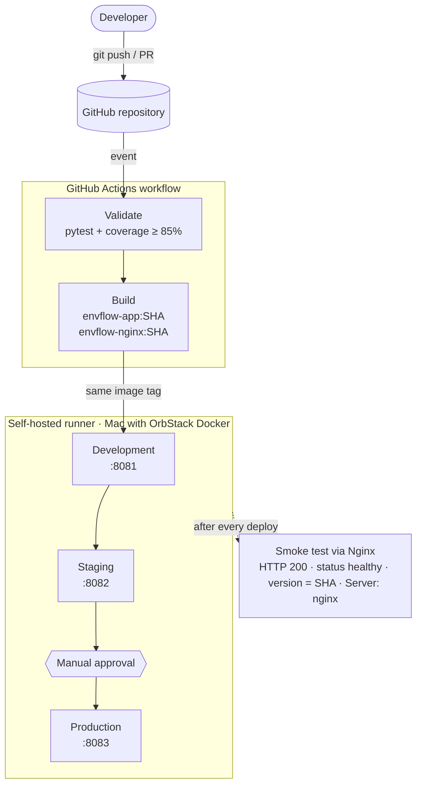
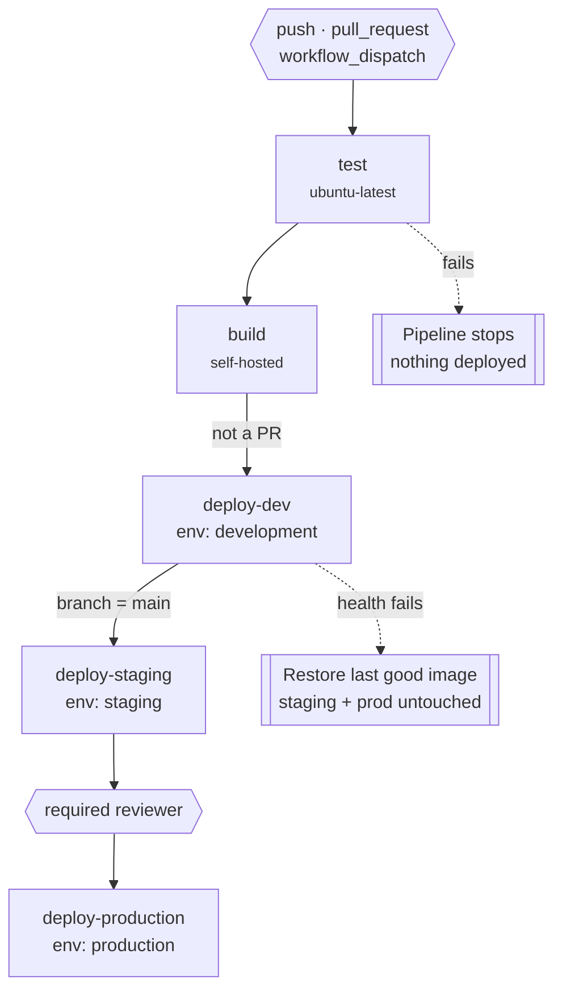
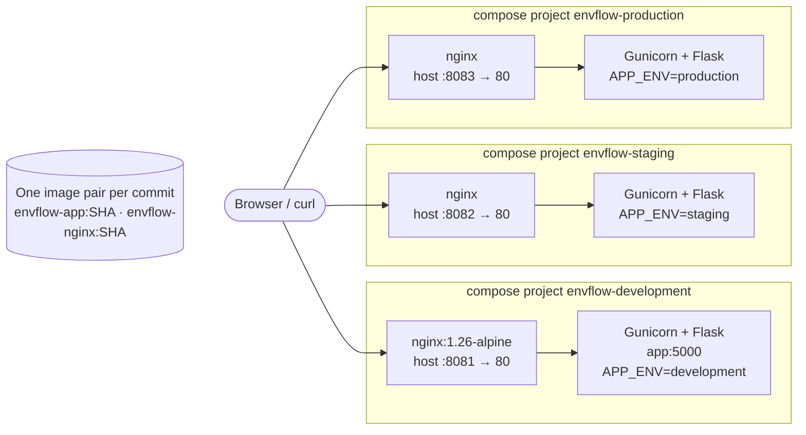
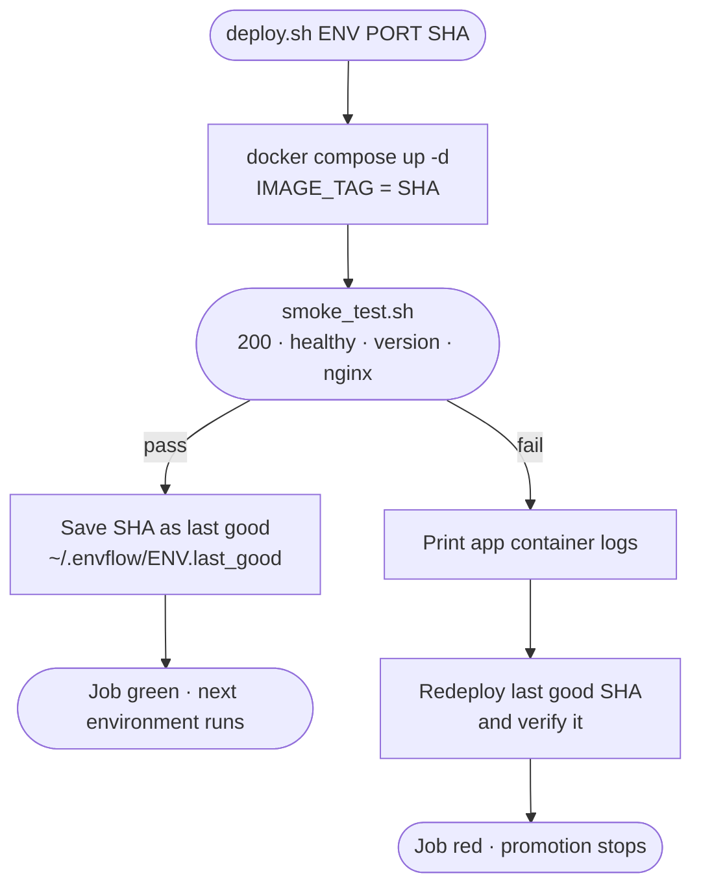

# EnvFlow · Multi-Environment CI/CD Pipeline

Automated build, test and deployment of a Flask web app across **Development**, **Staging** and **Production** with **GitHub Actions**, **Docker** and **Nginx**.

DevOps Lab Project · K.J. Somaiya School of Engineering · Om Anand Jha (16010123214), Om Dwivedi (16010123213), Paaras Kokate (16010123224)

📄 **Project report:** [docs/report/EnvFlow_Report.pdf](docs/report/EnvFlow_Report.pdf)

| Environment | URL | Deploys when | Protection |
|---|---|---|---|
| Development | http://localhost:8081 | push to `main`, `dev`, `feature/**` | smoke test |
| Staging | http://localhost:8082 | push to `main`, after Development passes | smoke test |
| Production | http://localhost:8083 | after Staging passes | **required reviewer** + smoke test |

## Architecture



## Pipeline jobs



## Runtime: one compose project per environment



## What deploy.sh does



Rendered SVG and PNG versions of every diagram (plus the Nginx routing and sequence diagrams) are in [`docs/diagrams`](docs/diagrams).

## Repository layout

```
app.py                         Flask app: dashboard, /add, /delete/<id>, /health
templates/index.html           Environment aware dashboard
static/style.css               Served directly by Nginx
tests/test_app.py              8 pytest cases, coverage gate 85%
Dockerfile                     App image (python:3.12-slim + Gunicorn), SHA baked in
nginx/Dockerfile, nginx.conf   Nginx image: reverse proxy + static files
docker-compose.yml             One stack (app + nginx), parameterised by APP_ENV / HOST_PORT / IMAGE_TAG
.github/workflows/cicd-pipeline.yml   test → build → deploy-dev → deploy-staging → deploy-production
scripts/deploy.sh              compose up, smoke test, record last good SHA, restore on failure
scripts/smoke_test.sh          Checks HTTP 200, status healthy, version = SHA, Server: nginx
scripts/setup_github.sh        Creates repo, environments, reviewer rule, secrets via gh
scripts/demo_helper.sh         status / open / break-test / break-health helpers for the demo
docs/                          Diagrams, screenshots, report PDF
```

## Setup (macOS + OrbStack)

1. Start OrbStack, then check `docker compose version`.
2. Run `./scripts/setup_github.sh`. It creates the repo, the 3 environments, the production reviewer rule and the secrets.
3. Add a self-hosted runner. Open the link the script prints, then run the `config.sh` commands it shows in `~/actions-runner`. Keep the default labels.
4. Start the runner in a terminal: `cd ~/actions-runner && ./run.sh`
5. Push: `git push -u origin main`

## Demo commands

```bash
./scripts/demo_helper.sh status        # /health of all 3 environments
./scripts/demo_helper.sh containers    # running containers and port mappings
./scripts/demo_helper.sh open          # open :8081 :8082 :8083
curl -sI localhost:8083                # Server: nginx
./scripts/demo_helper.sh break-test    # make a test fail, then commit + push
./scripts/demo_helper.sh fix-test
./scripts/demo_helper.sh break-health  # dispatch a run where the new Dev container is unhealthy
```

## Run locally without GitHub

```bash
pip install -r requirements.txt && pytest
./scripts/demo_helper.sh local-up
```
